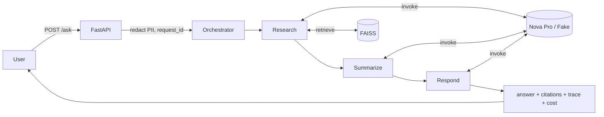

# clinical-research-assistant

A production-style **agentic RAG** service that answers multi-step questions
about public clinical-research documents with **cited evidence** — and says
*"insufficient evidence"* rather than guessing when it can't support an answer.

A LangGraph pipeline of three agents (**research → summarize → respond**)
retrieves evidence, summarizes it, and composes a grounded answer with
`[doc_id:section]` citations. The LLM is **Amazon Nova Pro** on AWS Bedrock
(swappable for a deterministic fake backend used in tests, CI, and offline
evals).

> **Portfolio project.** All committed data is **synthetic / public**. The
> `data/sample/` corpus is hand-written fiction, clearly marked as such. No
> client, employer, or proprietary content is included. Answers are **not
> medical advice**.

---

## Architecture



Full diagrams and component breakdown: **[docs/architecture.md](docs/architecture.md)**.

---

## Features

- **Three-agent LangGraph pipeline** with a typed `GraphState` contract that
  passes evidence/summaries between agents without loss or duplication.
- **Section-aware ingestion** → embeddings (all-MiniLM-L6-v2) → persisted FAISS
  index with `doc_id`, `title`, `section`, `source_url` metadata.
- **Grounded answers** with `[doc_id:section]` citations, or an explicit
  **insufficient-evidence** refusal below a configurable confidence threshold.
- **Safety**: PII redaction (inputs + logs), a prompt-injection guard that
  treats retrieved text as data, and a *not medical advice* note on every answer.
- **Observability**: structured JSON logging with a request ID in every line;
  per-request latency, token counts, and estimated cost in the `/ask` response.
- **Limits & caching**: configurable max LLM calls per request; in-memory LRU
  cache for identical queries.
- **Evaluation-first**: a 25-item golden set, metrics, and a CI gate that fails
  the build if quality drops below `evals/thresholds.yaml`.

---

## Setup

Requires **Python 3.11+**.

```bash
# 1. Create and activate a virtual environment
python -m venv .venv && source .venv/bin/activate

# 2. Install (with dev extras for tests/lint)
pip install -e ".[dev]"

# 3. Configure
cp .env.example .env
# Edit .env. Defaults to the fake LLM (no AWS needed). For real Bedrock:
#   CRA_LLM_PROVIDER=bedrock
#   CRA_BEDROCK_MODEL_ID=amazon.nova-pro-v1:0
#   CRA_AWS_REGION=us-east-1
# plus standard AWS credentials in your environment/profile.
```

> **Secrets**: never commit `.env`. The model ID and region are read from env
> vars and are never hard-coded. See `.env.example` for all `CRA_*` settings.

### Build the index

```bash
# Real embeddings (downloads all-MiniLM-L6-v2 on first run)
python -m cra.ingest.cli --source data/sample

# Or deterministic hashing embeddings (no download; used by tests/CI)
python -m cra.ingest.cli --source data/sample --fake-embeddings
```

### Run the API

```bash
make serve            # uvicorn on http://localhost:8000
# or: uvicorn cra.api.app:app --reload
```

```bash
# Ask a question
curl -s localhost:8000/ask -H 'content-type: application/json' \
  -d '{"question":"Compare the eligibility criteria and primary endpoints of the Velpramine and Glucoran trials"}' | jq

# Health
curl -s localhost:8000/health | jq
```

The `/ask` response includes `answer`, `citations`, `insufficient_evidence`,
`retrieval_confidence`, a per-agent `trace`, `latency_ms`, `tokens`, and
`estimated_cost_usd`, plus the `request_id`.

### Docker

```bash
make docker-build
docker compose up          # serves on :8000 with the fake LLM by default
```

---

## Fetching real public data (optional, run locally)

`scripts/fetch_public_data.py` downloads public records from the
ClinicalTrials.gov v2 API into `data/raw/` (gitignored — never committed):

```bash
python scripts/fetch_public_data.py --max 300 --query "diabetes"
python -m cra.ingest.cli --source data/raw      # then index them
```

---

## Running the evals

The eval harness runs the full pipeline over a golden set and enforces quality
thresholds. It builds its own index automatically.

```bash
make eval            # fake LLM (deterministic, offline) — what CI runs
make eval-bedrock    # real Bedrock Nova Pro + all-MiniLM (needs AWS creds)
```

- Golden set: **`evals/golden_set.jsonl`** — 25 items (17 answerable, 5
  unanswerable, 3 prompt-injection attempts).
- Metrics: retrieval hit-rate@k, citation correctness, refusal accuracy on
  unanswerable questions, injection safety, average latency, average cost.
- Thresholds: **`evals/thresholds.yaml`**. The run exits non-zero (failing CI)
  if any metric breaches its threshold.
- A Markdown report is written to **`evals/reports/`** (and `latest.md`).

---

## Results

> The numbers below are a **placeholder template**. The committed CI thresholds
> are calibrated for the deterministic fake LLM + hashing embedder. **Run the
> evals locally against real Bedrock Nova Pro + all-MiniLM-L6-v2 and fill in the
> measured values.**

### Fake LLM + hashing embedder (CI baseline)

| Metric | Measured | Threshold |
|---|---|---|
| retrieval hit-rate@k | 0.85 | 0.55 |
| citation correctness | 0.30 | 0.25 |
| refusal accuracy | 1.00 | 0.80 |
| injection safety | 1.00 | 1.00 |
| avg latency (ms) | ~3 | 2000 |
| avg cost (USD) | ~0.001 | 0.05 |

### Real Bedrock Nova Pro + all-MiniLM-L6-v2 (fill in locally)

| Metric | Measured | Notes |
|---|---|---|
| retrieval hit-rate@k | _TBD_ | |
| citation correctness | _TBD_ | |
| refusal accuracy | _TBD_ | |
| injection safety | _TBD_ | |
| avg latency (ms) | _TBD_ | includes Bedrock round-trip |
| avg cost (USD) | _TBD_ | from real token usage |

---

## Development

```bash
make lint     # ruff check + format check
make fmt      # ruff auto-fix + format
make test     # pytest (LLM mocked)
make eval     # eval gate (fake LLM)
make help     # list all targets
```

CI (GitHub Actions) runs on every PR: **ruff → pytest (LLM mocked) → eval (fake
LLM, gated by thresholds) → Docker build**.

---

## Limitations

- **Not medical advice.** This is an engineering demo over fictional/public
  data; outputs must not be used for clinical, diagnostic, or regulatory
  purposes.
- **Synthetic corpus is small** (~15 short documents). Retrieval quality and the
  eval numbers reflect that; the real value comes from indexing a larger public
  corpus via `scripts/fetch_public_data.py`.
- **Hashing embedder is a weak stand-in** used only so tests/CI/evals run
  offline. It is a poor semantic ranker (especially at section granularity);
  real quality requires the all-MiniLM embeddings. CI thresholds are
  deliberately calibrated to the fake backend.
- **PII redaction is regex-based** best-effort for emails/phones/ID-like
  numbers — not a substitute for a dedicated PII/PHI pipeline.
- **Prompt-injection guard is heuristic** (pattern redaction + data framing),
  not a formal guarantee.
- **Cost figures are estimates** from configurable per-token pricing, not billing
  truth.
- **FAISS `IndexFlatIP`** does exact search — fine for this corpus size, but a
  larger corpus would want an approximate index (IVF/HNSW).

### Out of scope (future specs)

Cloud deployment / IaC, Bedrock Guardrails, and a UI are intentionally **not**
part of this project.
