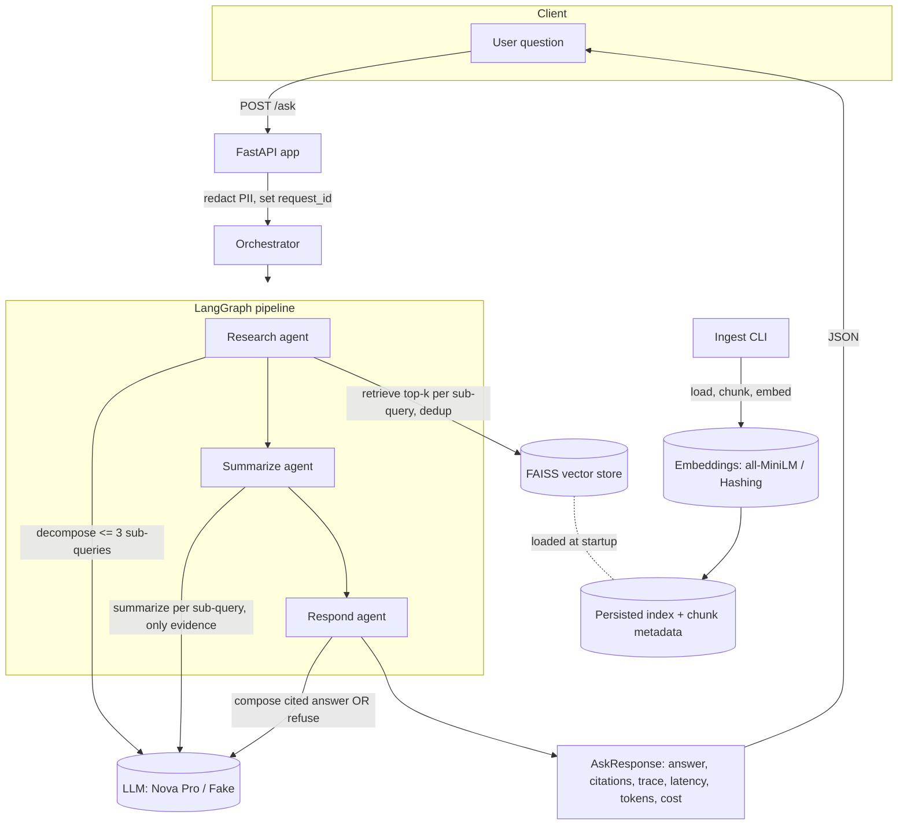
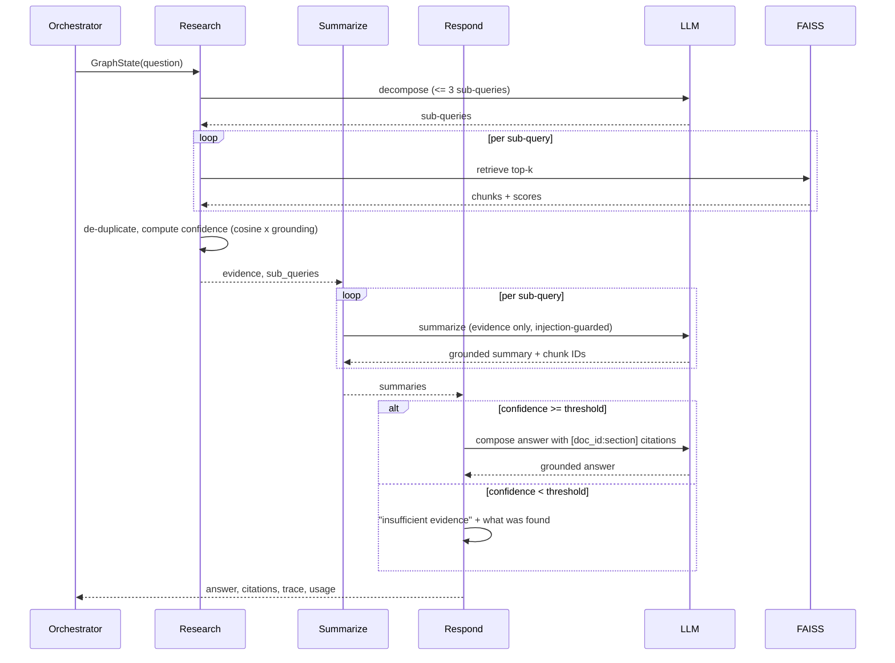

# Architecture

`clinical-research-assistant` (package `cra`) is an agentic RAG service that
answers multi-step questions about clinical-research documents with cited
evidence, and explicitly refuses when the evidence is insufficient.

## High-level flow

## Components

| Layer | Package | Responsibility |
|---|---|---|
| Config | `cra.config` | Pydantic-settings; all tunables from `CRA_*` env vars. Bedrock model ID + region are injected, never hard-coded. |
| Ingestion | `cra.ingest` | Load docs, parse front-matter + sections, section-aware chunking, build & persist the FAISS index. |
| Retrieval | `cra.retrieval` | Embedding backends (real + hashing fake), FAISS store, multi-sub-query retrieval with de-duplication. |
| LLM | `cra.llm` | Backend abstraction, Bedrock Nova Pro adapter, deterministic fake, LRU cache + per-request call limit, token/cost accounting. |
| Agents | `cra.agents` | Research / summarize / respond nodes, prompts, prompt-injection guard. |
| Graph | `cra.graph` | Typed `GraphState` contract, LangGraph wiring, request orchestrator. |
| API | `cra.api` | FastAPI `POST /ask` + `GET /health`, request/response schemas. |
| Observability | `cra.observability` | Structured JSON logging with request-ID propagation, PII redaction. |
| Evals | `cra.evals` | Golden set, metrics, threshold gate, Markdown reports. |

## The three agents

### Research agent
Decomposes the question into at most `CRA_MAX_SUB_QUERIES` sub-queries, retrieves
`CRA_RETRIEVAL_TOP_K` chunks per sub-query, de-duplicates (best score per chunk),
and writes evidence + a blended confidence score into graph state. Confidence is
`mean_cosine x lexical_grounding`, where grounding is the fraction of the
question's salient terms present in the retrieved evidence (and titles). This
makes the refusal gate robust even when the embedder is weak or the question is
off-topic.

### Summarize agent
Produces one summary per sub-query using **only** the retrieved evidence. Each
summary carries the chunk IDs it drew from. Evidence is sanitized by the
prompt-injection guard and presented inside a clearly delimited untrusted-data
block.

### Respond agent
If confidence is below `CRA_CONFIDENCE_THRESHOLD` (or there is no evidence),
returns an explicit *insufficient evidence* response describing what little was
found — it never guesses. Otherwise it composes the final answer with
`[doc_id:section]` citations. Every answer carries a *not medical advice* note.

## Typed state contract

`cra.graph.state.GraphState` (Pydantic) is the single contract threaded between
agents. Each agent reads the fields it needs and writes only the fields it owns,
so evidence and summaries pass through without loss or duplication. This
invariant is covered by dedicated tests (`tests/test_graph_state_contract.py`).

## Safety

- **PII redaction** on the inbound question and on log messages (emails, phone
  numbers, long ID-like numbers), preserving clinical numbers like doses and
  percentages.
- **Prompt-injection guard**: retrieved text is always treated as data, wrapped
  in an untrusted-data block, and common injection markers are redacted before
  reaching the model.
- **Not medical advice**: every answer carries the disclaimer.
- **Insufficient-evidence refusal**: the service refuses rather than
  hallucinating when retrieval confidence is low.

## LLM backends

- **Bedrock** (`CRA_LLM_PROVIDER=bedrock`): Amazon Nova Pro via `langchain-aws`,
  model ID + region from env, with retries. Real usage metadata drives cost.
- **Fake** (`CRA_LLM_PROVIDER=fake`, default): deterministic, offline,
  evidence-grounded backend driven by `TASK:` tags. Used for all tests, CI, and
  offline eval runs so nothing calls AWS by accident.

An LRU cache (process-global) short-circuits identical prompts; a per-request
budget caps non-cached LLM calls.
